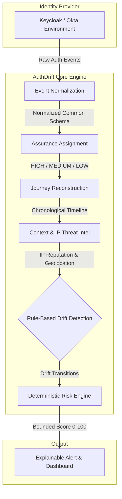
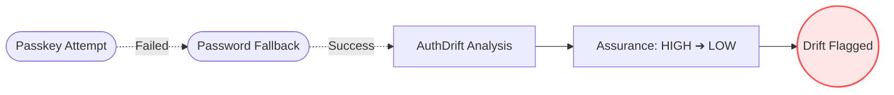

# AuthDrift: Authentication Assurance Drift Detection and Threat Intelligence

  

**AuthDrift** is a lightweight, vendor-neutral monitoring layer for analyzing **authentication assurance** and **threat intelligence** across a user's entire authentication journey.

Rather than viewing authentication events as isolated logs (e.g., "login failed," "password successful"), AuthDrift reconstructs a connected chronological timeline. By doing so, it detects when a user begins with a strong authentication method but falls back to a weaker one within the same session—a phenomenon known as **Authentication Assurance Drift**.

In addition, AuthDrift seamlessly correlates **IP Threat Intelligence** (powered by AbuseIPDB) to identify whether authenticating IP addresses have a history of malicious activity, without blocking or compromising core authentication analysis.

---

## 🏗️ System Architecture & Pipeline

AuthDrift acts as a correlation layer that sits above identity providers like Keycloak and Okta. It normalizes raw events, determines their relative assurance levels, checks IP reputation, and analyzes the chronological journey.



---

## 🔍 The Core Concept: Assurance Drift

Modern identity systems generate thousands of individual events. A passkey failure might be normal. A password login might be permitted. But a *passkey failure followed immediately by a password login* represents a meaningful reduction in authentication assurance. 

AuthDrift flags this transition and explains the context, distinguishing it from isolated events:



> **Note:** An assurance downgrade is *not* definitive proof of an active compromise. Legitimate account recovery or new device migrations can trigger fallback. AuthDrift explains the transition and assigns an explainable risk score (0–100) so security teams have transparent context.

---

## 🛡️ IP Threat Intelligence Subsystem

AuthDrift features a modular IP Threat Intelligence subsystem (`backend/threat_intelligence/`) integrating external IP reputation feeds:

- **Provider**: [AbuseIPDB](https://www.abuseipdb.com/) v2 API check endpoint.
- **Provider-Independent Abstraction**: Abstract `BaseThreatIntelligenceProvider` allowing seamless addition of VirusTotal, AlienVault, or local feeds.
- **Pre-Lookup IP Validation**: Built-in IPv4/IPv6 validation using Python's `ipaddress` module. Private (`10.0.0.0/8`, `192.168.0.0/16`, `172.16.0.0/12`), loopback (`127.0.0.1`, `::1`), link-local, and reserved documentation testnets are flagged as `STATUS_PRIVATE` locally and never leaked externally.
- **Thread-Safe In-Memory Cache**: Configurable TTL cache (default: 24 hours / 86400s) minimizes redundant external queries and respects provider rate limits. Transient failures (`UNKNOWN`) are never cached.
- **Fail-Open Safe Operation**: If AbuseIPDB is unreachable, times out, or returns HTTP 429 rate limits, AuthDrift safely marks status as `UNKNOWN` and continues journey analysis without crashing.
- **Deterministic Factor 7 Risk Weighting**: Confirmed malicious IPs (`KNOWN_MALICIOUS`, abuse confidence score ≥ 50%) contribute up to 25 bounded risk points. Suspicious IPs (abuse score 20–49%) contribute up to 10 points. Clean and Unknown IPs add 0 points.
- **Alert Priority Escalation**: Identified malicious IP activity automatically elevates alert priority to `HIGH_PRIORITY`.

---

## 📦 System Directory Structure

```text
AuthnDrift/
├── Dockerfile                   # Production Python 3.11 slim container definition
├── docker-compose.yml           # Unified deployment for AuthDrift + Keycloak
├── .dockerignore                # Build context isolation
├── .env.example                 # Environment configuration template
├── requirements.txt             # Managed Python dependencies
├── backend/
│   ├── api.py                   # FastAPI service with lifespan and health check
│   ├── engine.py                # Core security orchestration facade
│   ├── pipeline/                # End-to-end ingestion and execution pipeline
│   ├── models/                  # Common schema, assurance, and detection models
│   ├── assurance/               # Relative assurance levels and assignment rules
│   ├── normalization/           # Keycloak and Okta raw event normalizers
│   ├── journey/                 # Chronological journey reconstruction
│   ├── detection/               # Drift detection state machine (Rule A & Rule B)
│   ├── correlation/             # Context analyzer and location profiler
│   ├── risk/                    # Deterministic risk engine (Factors 1-7)
│   ├── alerts/                  # Explainable alert generator
│   └── threat_intelligence/     # AbuseIPDB provider, service & TTL cache
├── dashboard/                   # Interactive web visualizer (Vanilla HTML/CSS/JS)
├── keycloak/                    # Keycloak realm configuration & fixture generator
├── sample-data/                 # Pre-generated reproducible test datasets
└── tests/                       # Automated pytest verification suite
```

---

## ⚙️ Configuration & Environment Variables

Copy the example environment configuration file:

```bash
cp .env.example .env
```

| Variable | Description | Default |
| :--- | :--- | :--- |
| `PORT` | Web API port | `8000` |
| `HOST` | Web API bind host | `0.0.0.0` |
| `ABUSEIPDB_API_KEY` | AbuseIPDB API key (optional for demo/tests) | `""` |
| `AUTH_DRIFT_ENABLE_THREAT_INTEL` | Enable/disable external threat intel lookups | `true` |
| `AUTH_DRIFT_IP_CACHE_TTL` | Threat intelligence cache duration (seconds) | `86400` (24h) |
| `KEYCLOAK_SERVER_URL` | Upstream Keycloak URL for integrated demo | `http://localhost:8080` |
| `KEYCLOAK_REALM` | Upstream Keycloak realm name | `authdrift` |

> [!IMPORTANT]
> Never commit real API keys or `.env` files into source control. AuthDrift runs 100% locally and passes all automated tests without requiring an active external API key.

---

## 🚀 Execution Guide

### Option 1: Running Locally (FastAPI Service)

1. **Install dependencies:**
   ```bash
   python -m pip install --upgrade pip
   pip install -r requirements.txt
   ```

2. **Start the background service:**
   ```bash
   uvicorn backend.api:app --host 0.0.0.0 --port 8000 --reload
   ```

3. **Access the Application:**
   - **Interactive Dashboard:** `http://localhost:8000/`
   - **Operational Health Probe:** `http://localhost:8000/api/health`
   - **Interactive OpenAPI Docs:** `http://localhost:8000/docs`

---

### Option 2: Running with Docker & Docker Compose

Deploy the complete integrated AuthDrift stack (AuthDrift API + Keycloak IDP):

1. **Validate Compose Configuration:**
   ```bash
   docker compose config
   ```

2. **Build and Launch Containers:**
   ```bash
   docker compose up -d
   ```

3. **Verify Service Status:**
   ```bash
   docker compose ps
   ```

4. **View Application Logs:**
   ```bash
   docker compose logs -f authdrift
   ```

5. **Stop Containers:**
   ```bash
   docker compose down
   ```

---

## 🧪 Simulation Test Suite (Categories A–E)

AuthDrift includes a simulation test matrix covering 5 distinct verification categories:

| Category | Description | Representative Scenario | Expected Outcome |
| :--- | :--- | :--- | :--- |
| **Category A** | Informational Scenarios | Passkey on known device & IP | Assigned HIGH assurance; score 0; `INFORMATIONAL` alert. |
| **Category B** | Contextual Anomalies | New device / Changed IP | Contextual signals flagged without assurance drift; score 20–35. |
| **Category C** | Assurance Drift | Rule A Fallback / Rule B Step-Down | Downgrade detected; transition flagged; score 40–80. |
| **Category D** | Recovery Scenarios | Migration on known hardware | Degradation recorded with non-accusatory operational caveat. |
| **Category E** | Threat Intelligence | Public Malicious IP (AbuseIPDB 85%) | Status `KNOWN_MALICIOUS`; Factor 7 risk added; `HIGH_PRIORITY`. |

---

## 🔬 Synthetic Benchmark & Academic Literature

AuthDrift includes a reproducible synthetic dataset generator (`sample-data/research_paper_synthetic_dataset.json`) containing **145 synthetic enterprise authentication journeys** aligned with concepts from published authentication and risk-based security literature (the cohort counts below are synthetic benchmark parameters, not empirical measurements from those studies):

1. **Lyastani et al. (IEEE S&P 2020)**: *"Is FIDO2 the Kingslayer of User Authentication? A Comparative Usability Study."* — Examines FIDO2/WebAuthn usability, account recovery friction, and fallback challenges.
2. **Wiefling et al. (ACSAC 2020)**: *"More Than Just Good Passwords? A Study on Usability and Security Perceptions of Risk-Based Authentication."* — Examines risk-based contextual verification during login and fallback flows.
3. **Kent, A. D. (LANL 2015/2016)**: *"Comprehensive, Multi-Source Cyber-Security Events."* — Enterprise multi-source authentication event schema and synthetic baseline/anomaly cohort modeling.
4. **Bonneau et al. (IEEE S&P 2012)**: *"The Quest to Replace Passwords: A Framework for Comparative Evaluation."* — Establishes comparative assurance evaluation frameworks.
5. **Alaca & van Oorschot (ACSAC 2016)**: *"Device Fingerprinting for Augmenting Web Authentication: Classification and Analysis of Methods."* — Hardware continuity and device fingerprint stability.
6. **Freeman et al. (NDSS 2016)**: *"Who Are You? A Statistical Approach to Measuring User Authenticity."* — Contextual anomalies, location, and IP-based risk modeling.
7. **Doerfler et al. / Thomas (WWW 2019)**: *"Evaluating Login Challenges as a Defense Against Account Takeover."* — Account hijacking defenses and suspicious login challenges.

### Prototype Limitations

- **In-Memory Baselines**: User device, IP, and `LocationProfiler` baselines exist strictly in process memory during execution and do not persist across container restarts.
- **VPN / Proxy Detection (`NOT_VERIFIED`)**: AuthDrift does not infer VPN or proxy usage solely from IP address changes; without an external network-anonymizer telemetry source, `vpn_proxy_status` remains `NOT_VERIFIED`.
- **No LLM Integration**: All detection, case classification (Cases 1–5), correlation, and scoring execute deterministically without external LLM APIs.

To re-generate or run the benchmark:
```bash
# Re-generate synthetic dataset from research specifications:
python -m backend.synthetic_data.research_dataset_generator

# Execute the automated benchmark verification suite:
pytest tests/test_simulation_suite.py -k "TestResearchPaperSyntheticBenchmark" -v
```

---

## 🎯 Benchmark Case Studies: Client Continuity vs. Adversarial Downgrade

| Scenario | User | Device | IP Address | Auth Sequence | System Classification | Rationale |
| :--- | :--- | :--- | :--- | :--- | :--- | :--- |
| **Benign Recovery** | **Bob** | `laptop-01` (Known) | `192.168.1.20` (Same) | Passkey Error ➔ Password Success | **`INFORMATIONAL`** (`is_recovery_candidate=True`, Score=0) | **Client Continuity Policy:** Legitimate user recovery on verified primary hardware and matching subnet is exempt from drift alerts. |
| **Adversarial Downgrade** | **Carol** | `unfamiliar-phone-99` (New) | `203.0.113.5` (Public/New) | Passkey Error ➔ Password Success | **`ASSURANCE_DRIFT`** (`is_recovery_candidate=False`, Score=75) | Attacker attempting downgrade from an unfamiliar endpoint triggers high-severity drift alert. |

---

### Running Tests

Execute the full suite across all modules:

```bash
pytest tests/ -v
```

Execute threat intelligence unit tests:

```bash
pytest tests/test_threat_intelligence.py -v
```

Execute the simulation scenarios:

```bash
pytest tests/test_simulation_suite.py -v
```

---

## 🌐 API Endpoints Reference

| Method | Endpoint | Description |
| :--- | :--- | :--- |
| `GET` | `/api/health` | Container healthcheck & threat intelligence readiness probe. |
| `GET` | `/api/overview` | Summary metrics, risk tier distribution, and processing totals. |
| `GET` | `/api/journeys` | List reconstructed journeys (supports `?user_id=` filtering). |
| `GET` | `/api/alerts` | List security alerts (supports `?drift_only=true` & severity filtering). |
| `POST` | `/api/pipeline/run` | Ingest arbitrary raw events (Keycloak or Okta format) asynchronously. |
| `GET` | `/api/scenarios` | List built-in controlled simulation scenarios (TC01–TC11). |
| `POST` | `/api/scenarios/{id}/load` | Load and execute a simulation scenario into the live dashboard. |
| `GET` | `/api/threat-intel/lookup` | Ad-hoc IP reputation lookup endpoint (`?ip=<address>`). |

---

## 👥 Integration Notes for Team Members

- **Common Event Schema**: Retained 100% backward compatibility. `ip_address` continues to be normalized onto `AuthenticationEvent`.
- **Context Evidence**: `ContextEvidence` now contains an optional `ip_reputation: Optional[IPReputationResult] = None`.
- **Security Alert**: `SecurityAlert` exposes `ip_reputation` and serializes cleanly into JSON for dashboard consumption.
- **Risk Score**: The 0–100 deterministic risk engine now includes **Factor 7 (IP Threat Intelligence)**. Base scores for existing tests without threat intelligence are completely unchanged.
